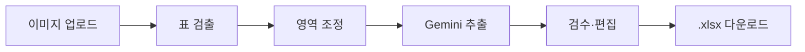

<div align="center">


# Image to Excel

**스캔·캡처 이미지에서 표를 찾고, 셀 단위로 읽어 `.xlsx`로 내보냅니다.**

[](https://react.dev/)
[](https://www.typescriptlang.org/)
[](https://vite.dev/)
[](https://developers.cloudflare.com/workers/)
[](https://ai.google.dev/)

[기능](#-기능) · [워크플로](#-워크플로) · [빠른 시작](#-빠른-시작) · [환경 변수](#-환경-변수) · [배포](#-배포)

</div>

---

## 개요

`image-to-excel`은 **브라우저에서 표 영역을 검출**하고, **Gemini로 표 내용을 JSON 구조화**한 뒤 **검수·편집 후 Excel 파일로 다운로드**하는 단일 페이지 워크숍입니다.

| 구분 | 설명 |
| --- | --- |
| **표 검출** | [Microsoft Table Transformer](https://github.com/microsoft/table-transformer) (ONNX, 브라우저 로컬 실행) |
| **표 인식** | Google **Gemini** — 구조화 JSON (`rows[].cells[]`) |
| **API·인증** | Cloudflare Workers (`/api/*`), 세션 쿠키 + 허용 사용자 목록 |
| **UI** | React 19, shadcn/ui (base-nova), Tailwind CSS 4, Motion |

> 표 검출 모델은 MIT 라이선스이며, Hugging Face 미러(`/hf` 프록시)로 모델을 받아옵니다. 상업적 이용 전 라이선스를 확인하세요.

---

## ✨ 기능

- **다중 이미지 큐** — 여러 파일을 올리고 파일별 진행 상태를 유지
- **표 검출 & BBox 편집** — 자동 박스 + 드래그·이름·영역(시트) 관리
- **Pan/Zoom 프리뷰** — 고해상도 원본에서 영역 확인
- **AI 표 추출** — 영역별 Gemini 호출, 셀 단위 미리보기·인라인 수정
- **Excel 내보내기** — `xlsx` 생성 및 다운로드
- **다크 모드** — 시스템 연동 + 수동 토글
- **접근성** — `prefers-reduced-motion` 존중

---

## 🔄 워크플로



| 단계 | 화면 | 하는 일 |
| --- | --- | --- |
| **표 검출** | Detect | 모델 추론, BBox 확인·수정 |
| **엑셀 변환** | Convert | 영역 이미지로 셀 데이터 추출 |
| **검수 및 다운로드** | Review | 표 내용 확인 후 Excel 저장 |

---

## 🏗 아키텍처

```text
┌─────────────────────────────────────────────────────────┐
│  Browser (Vite SPA)                                     │
│  · Table Transformer (ONNX / transformers.js)           │
│  · Workshop UI · IndexedDB 진행 상태                     │
└───────────────────────────┬─────────────────────────────┘
                            │ /api/*  (dev: Vite proxy)
                            ▼
┌─────────────────────────────────────────────────────────┐
│  Cloudflare Worker                                      │
│  · 로그인·세션 · /api/extract-table → Gemini            │
│  · /hf/* Hugging Face 프록시 · static assets (dist)     │
└─────────────────────────────────────────────────────────┘
```

---

## 🚀 빠른 시작

### 요구 사항

- **Node.js** 20+
- **npm** 10+
- [Google AI Studio](https://aistudio.google.com/apikey) **Gemini API 키**
- (배포 시) [Cloudflare](https://dash.cloudflare.com/) 계정 + `wrangler login`

### 설치 & 로컬 실행

```bash
git clone https://github.com/happy789515/image-to-excel.git
cd image-to-excel
npm install

cp .dev.vars.example .dev.vars
# .dev.vars 에 GEMINI_API_KEY, SESSION_SECRET, AUTH_USERS 설정

# 터미널 1 — API (8787)
npm run dev:worker

# 터미널 2 — 프론트 (Vite, /api → worker 프록시)
npm run dev
```

브라우저에서 Vite가 안내하는 주소(보통 `http://localhost:5173`)로 접속한 뒤, `.dev.vars`의 사용자로 로그인합니다.

첫 실행 시 **Table Transformer ONNX 모델** 다운로드로 부팅 화면이 잠시 표시될 수 있습니다.

### 자주 쓰는 스크립트

| 명령 | 용도 |
| --- | --- |
| `npm run dev` | 프론트엔드만 (HMR) |
| `npm run dev:worker` | 빌드 후 Wrangler 로컬 Worker + 정적 자산 |
| `npm run build` | 타입체크 + 프로덕션 번들 → `dist/` |
| `npm run lint` | ESLint |
| `npm run deploy` | 빌드 후 Cloudflare 배포 |
| `npm run verify:workers` | Workers 자산·dry-run 검증 |

---

## 🔐 환경 변수

로컬 Worker는 프로젝트 루트의 **`.dev.vars`** 를 사용합니다. `.dev.vars`는 git에 포함하지 마세요.

| 변수 | 필수 | 설명 |
| --- | ---: | --- |
| `GEMINI_API_KEY` | ✅ | Google Gemini API 키 |
| `SESSION_SECRET` | ✅ | 세션 쿠키 HMAC용 긴 랜덤 문자열 |
| `AUTH_USERS` | ✅ | JSON 배열 `[{"username":"…","password":"…"}]` |

프로덕션에서는 Cloudflare 대시보드 또는 `wrangler secret put` 으로 동일 이름의 시크릿을 설정하세요.

헬스 체크: Worker 실행 후 `GET /api/health` → `auth.sessionSecret`, `auth.authUsers` 설정 여부 확인.

---

## ☁️ 배포

```bash
npm run deploy
```

`wrangler.jsonc` 가 `dist/` 를 SPA로 서빙하고, API 라우트는 Worker가 처리합니다. 배포 전에 Cloudflare 쪽에 위 시크릿 세 종을 반드시 넣어야 `/api/extract-table` 이 동작합니다.

---

## 📁 프로젝트 구조

```text
image-to-excel/
├── src/              # React 앱 (워크숍, 검출, UI)
├── worker/           # Cloudflare Worker (auth, Gemini, HF 프록시)
├── public/           # favicon, web manifest
├── scripts/          # 배포 검증 등
├── wrangler.jsonc
└── vite.config.ts    # dev 시 /api, /hf 프록시
```

---

## ⚠️ 주의

- 이미지 업로드는 **PNG / JPEG / WebP**, Worker 기준 **약 8MB** 제한이 있습니다.
- Gemini 호출은 **로그인 세션**이 있어야 하며, API 키는 브라우저에 노출되지 않습니다.
- 표 검출은 기기 성능에 따라 초기 로딩·추론 시간이 길어질 수 있습니다.

---

## 🤝 기여

이슈·PR 환영합니다. 변경 전 `npm run lint` 와 `npm run build` 가 통과하는지 확인해 주세요.

---

<div align="center">

**이미지 한 장으로 표 복사·붙여넣기 대신, 구조화된 스프레드시트를.**

</div>